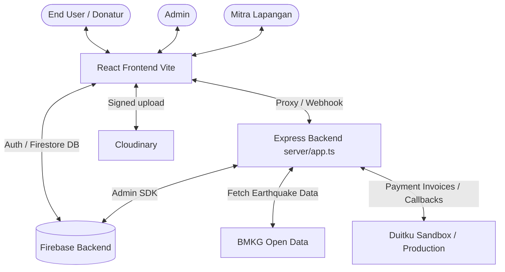

# Architecture Overview

## Tech Stack

- **Frontend:** React 19, Vite, TypeScript, TailwindCSS v4, React Router
- **Backend:** Express (Node.js 22, TypeScript) — modular `server/routes/`
- **Database:** Firebase Firestore
- **Authentication:** Firebase Auth (Client) + Firebase Admin SDK (server) + Custom staff session
- **Payment Gateway:** Duitku Direct API (QRIS only)
- **Deploy:** Vercel (serverless function + static Vite build)

## System Architecture



## Backend Layout (`server/`)

```text
server/
├── app.ts            # Entry point: express app, mounts routes, Vite middleware (dev) / static dist (prod)
└── routes/
    ├── bmkg.ts        # GET /api/bmkg/autogempa, /gempaterkini  (8s timeout, 502 on failure)
    ├── payments.ts    # POST /create, /callback, /check-status, /simulate-paid, GET /expire-sweep
    ├── transparency.ts# GET /api/transparency/summary
    ├── admin.ts       # POST /create-partner, /reset-transactions
    └── images.ts      # POST /api/images/sign (Cloudinary signature)
```

On Vercel, `api/index.ts` exports the same `app` as a serverless function and returns JSON 404 for unmatched `/api/*` routes. In development (`NODE_ENV !== 'production'` and no `VERCEL` env), `server/app.ts` also runs the Vite middleware on port 3005 so frontend and backend share one process.

## Application Modules

### 1. Data Ingestion (BMKG)
- Frontend triggers a fetch via the backend proxy `/api/bmkg/*` (never direct browser → BMKG, due to CORS).
- Backend pulls JSON from BMKG (8s timeout, `502` on failure) and proxies it to the client.
- Frontend formats data to `Disaster` and pushes to Firestore with `status: 'pending_verification'`.

### 2. Verification & Partner Assignment
- Admin sees pending disasters on the dashboard.
- **No automated rule engine.** Admin must select an active **Mitra Lapangan** (Partner) and explicitly approve.
- Approved disasters are marked `admin_approved` and become visible on the public/donor pages. Everything before that is hidden (empty state for users).

### 3. Donation & Payments (Duitku QRIS)
- Donors select an `admin_approved` disaster and create a Donation in Firestore.
- Frontend (`src/services/duitku.ts`) calls `POST /api/payments/duitku/create`. The backend computes the 0,17% admin fee server-side and calls Duitku `inquiry` with `paymentMethod: 'SP'`.
- Backend returns `qrString` (QRIS) with `fee` + `totalAmount`. The checkout page renders the QR and polls `POST /api/payments/duitku/check-status`.
- Duitku sends the webhook to `POST /api/payments/duitku/callback`; the backend validates the HMAC-SHA256 signature, performs an idempotency check, and updates `payments`/`donations` (+ `trackingEvents`) **directly via Firebase Admin SDK**.
- User is redirected to `/transaction/status/:donationId`.

### 4. Distribution & Tracking
- Admin creates `Disbursement`; partners acknowledge receipt and submit `distributionReports` with Cloudinary evidence photos.
- `partnerAllocations` and `trackingEvents` keep donors informed; transparency summary is served publicly via `GET /api/transparency/summary` (Admin SDK) without relaxing `firestore.rules`.

## Security Posture
- **Firestore Rules** (`firestore.rules`): row-level isolation — users can only read/write their own donations; Admin/Partner roles get elevated, strictly verified access; pending disasters are invisible to the public.
- **Environment Variables**: all backend secrets are non-`VITE_` variables loaded from `.env`; never exposed to Vite bundles.
- **Idempotency**: Duitku callbacks (`callback`, `simulate-paid`, `expire-sweep`) never double-mutate a `paid` payment.
- **Signature validation**: callback HMAC-SHA256; inquiry MD5; check-status HMAC-SHA256 — matching Duitku docs.