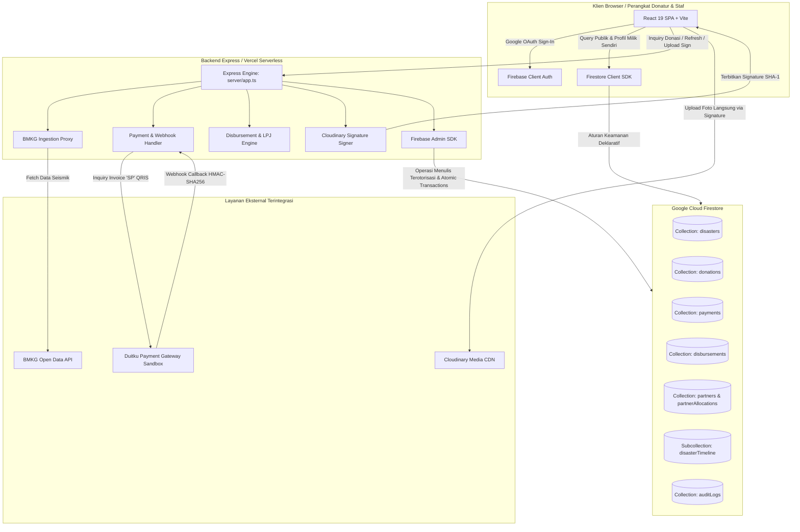
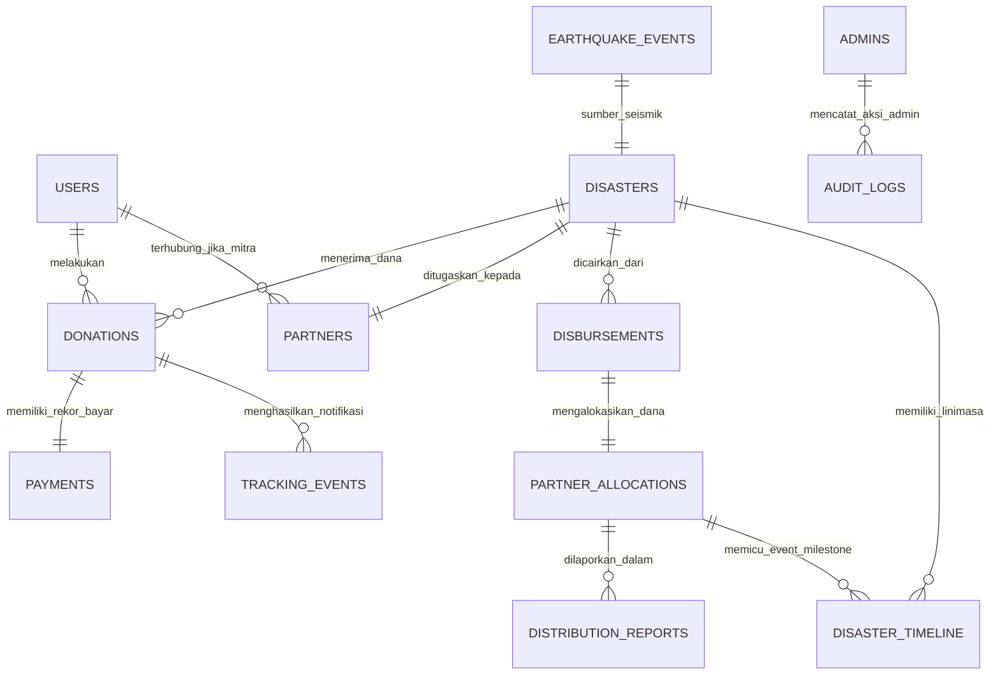
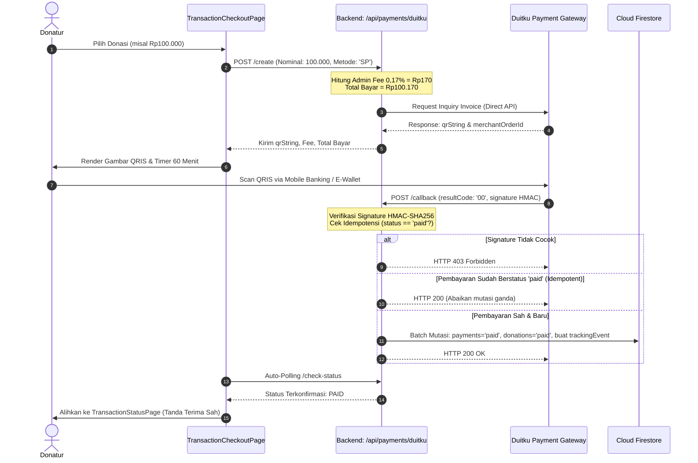
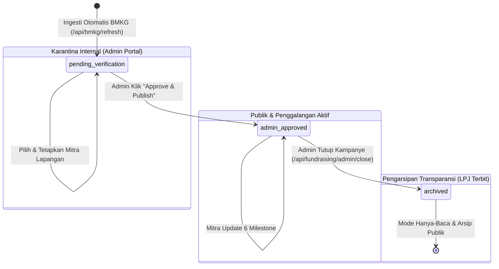

# Analisis Teknis Expected Product (Expected Product Technical Analysis)
## Platform Tanggap Darurat Bencana & Transparansi Donasi "Bersama Kita"

**Dokumen Pendukung Proposal Hackathon Tingkat Nasional**  
*Klasifikasi: Dokumen Arsitektur Sistem, Analisis Rekayasa Perangkat Lunak, dan Kesiapan Produk*  
*Status Audit: Terverifikasi dari Basis Kode Aktual (Codebase Grounded)*  

---

## 1. Ringkasan Eksekutif (Executive Summary)

**Bersama Kita** adalah platform tanggap darurat bencana dan transparansi penyaluran donasi terverifikasi yang dirancang untuk mengatasi krisis kepercayaan publik terhadap penggalangan dana di Indonesia. Platform ini memadukan **ingesti data gempabumi resmi BMKG secara terkarantina**, **gerbang pembayaran QRIS instan berbasis Duitku Direct API**, **tata kelola penugasan mitra lapangan terakreditasi**, **pencairan dana berbasis transaksi atomik database**, serta **pelacakan logistik bantuan 6 milestone berbukti foto dan geolokasi** yang dipublikasikan melalui garis waktu kolektif tanpa membocorkan data pribadi (*PII*) donatur.

Secara teknis, platform ini dibangun di atas arsitektur fullstack monolitik terpadu yang memadukan **React 19, TypeScript, dan Tailwind CSS v4** di sisi antarmuka pengguna dengan **Express 4 dan Firebase Admin SDK di lingkungan Node.js 22 LTS** sebagai backend serverless. Integritas data dijamin oleh aturan deklaratif **Cloud Firestore Security Rules**, validasi kriptografi **HMAC-SHA256**, dan **idempotensi webhook**.

Dokumen ini menyajikan analisis teknis mendalam terhadap 12 dimensi kapabilitas sistem aktual guna membuktikan bahwa produk yang diajukan bukan sekadar konsep antarmuka (*mockup*), melainkan sistem perangkat lunak yang beroperasi secara fungsional, teruji, dan siap didemonstrasikan secara langsung di hadapan dewan juri hackathon.

---

## 2. Gambaran Produk dan Nilai Teknis (Product Overview & Technical Value)

Platform konvensional penggalangan dana sering terjebak dalam masalah *Black Box Donation*—di mana donatur hanya menerima notifikasi transfer sukses tanpa pernah mengetahui kapan uang dicairkan, logistik apa yang dibeli, dan apakah barang benar-benar sampai ke tangan korban bencana. Di sisi lain, maraknya kampanye fiktif pascabencana mengikis kemauan masyarakat untuk berdonasi pada masa tanggap darurat (*golden hours*).

Nilai teknis yang dihadirkan **Bersama Kita** untuk menyelesaikan persoalan tersebut meliputi:

1. **Staged Disaster Quarantine Pipeline**: Mencegah hoaks dan penggalangan dana liar dengan memastikan setiap kampanye berakar dari data seismik resmi BMKG dan wajib diverifikasi oleh administrator platform sebelum tayang ke publik.
2. **Mandatory Partner Assignment Lock**: Mengikat pertanggungjawaban lapangan secara sah kepada organisasi mitra terverifikasi melalui aturan validasi sistem.
3. **Atomic Balance Outflow Protection**: Menghilangkan risiko selisih kas (*over-disbursement*) melalui transaksi atomik Firestore (`db.runTransaction()`) yang mengunci saldo donasi saat pencairan disetujui.
4. **6-Stage Logistics Stepper with Media CDN**: Menghadirkan pembuktian bertahap yang akuntabel melalui unggahan foto terverifikasi langsung ke Cloudinary CDN.
5. **Privacy-Preserving Collective Timeline**: Menggabungkan seluruh event pembaruan ke dalam subkoleksi linimasa publik per bencana sehingga seluruh donatur dapat memantau progres bantuan tanpa mengekspos kontak atau data pribadi donatur lain.

---

## 3. Tumpukan Teknologi Aktual dan Rasionil Pemilihan (Technology Stack & Rationale)

Berdasarkan audit langsung pada `package.json` dan konfigurasi repositori:

| Komponen Arsitektur | Teknologi Terpasang | Versi Aktual | Rasionil Pemilihan Berdasarkan Kebutuhan Sistem |
|---|---|---|---|
| **Frontend Framework** | React | `^19.0.1` | Performa rendering cepat, dukungan Server Component ready, dan ekosistem hooks stabil. |
| **Language & Typing** | TypeScript | `^7.0.2` (tooling: `~5.x`) | Menjamin *type-safety* end-to-end antara schema Firestore, request backend, dan state klien. |
| **Build Tool & Bundler** | Vite | `^8.3.0` | Hot Module Replacement (HMR) berkecepatan tinggi dan kemudahan integrasi middleware Express. |
| **Styling Engine** | Tailwind CSS v4 | `^4.3.3` | Konfigurasi CSS modern berbasis `@tailwindcss/vite`, performa rendering CSS instan, dan utilitas responsif. |
| **Routing Library** | React Router DOM | `^7.18.4` | Navigasi declarative multi-halaman tanpa reload dengan kontrol guard otorisasi rute. |
| **Backend Framework** | Express.js | `^4.21.2` | Minimalis, fleksibel, mudah dikonversi menjadi Vercel Serverless Function, dan stabil memproses webhook. |
| **Server Runtime** | Node.js (via tsx) | `22.x` (tsx `^4.21.0`) | Eksekusi langsung TypeScript di backend tanpa langkah transpilasi terpisah saat proses development. |
| **Database & Identity** | Google Cloud Firestore & Firebase Auth | `firebase ^12.19.0`, `firebase-admin ^14.5.0` | Fleksibilitas dokumen NoSQL, sinkronisasi realtime, isolasi keamanan aturan Firestore, dan Google OAuth. |
| **Payment Gateway** | Duitku Direct API | POP/Direct API Sandbox | Dukungan QRIS nasional instan, validasi webhook HMAC-SHA256, dan biaya transaksi transparan. |
| **Media Storage** | Cloudinary REST API | API v1_1 Signed | Penyimpanan foto bukti lapangan berkecepatan tinggi dengan CDN global tanpa membebani server backend. |
| **External Disaster Data**| BMKG Open Data API | TEWS JSON/XML | Sumber data gempa bumi resmi dan primer di wilayah kedaulatan Republik Indonesia. |

---

## 4. Arsitektur Sistem (System Architecture)

### 4.1 Ringkasan Arsitektur
Bersama Kita mengadopsi pola **Hybrid Client-Serverless Monolith**. Frontend React SPA disajikan oleh backend Express pada lingkungan pengembangan lokal, sementara pada lingkungan produksi Vercel, API backend dialihkan (*rewritten*) sebagai Serverless Functions (`api/index.ts`), dan aset frontend disajikan secara statis dari CDN tepi (*Edge CDN*).

### 4.2 Tanggung Jawab Komponen
- **React Frontend**: Mengelola state visual, navigasi pengguna, render QRIS interaktif, form donasi dengan kalkulasi biaya transparan, dan dashboard operasional mitra.
- **Express Backend**: Bertindak sebagai *trusted proxy*. Mengeksekusi logika yang memerlukan hak istimewa (Admin SDK), seperti pembuatan invoice Duitku, validasi webhook, otorisasi tanda tangan Cloudinary, dan transaksi atomik pencairan dana.
- **Firebase Client Auth & Firestore Rules**: Mengamankan pembacaan data langsung dari browser dengan membatasi data donasi privat hanya untuk pemiliknya dan mengunci data bencana yang belum disetujui.

---

## 5. Desain Database dan Relasi Data (Database Design & Relationships)

### 5.1 Inventaris Koleksi Cloud Firestore

| Koleksi Dokumen | Tujuan & Peran dalam Sistem | Kepemilikan & Hak Akses (`firestore.rules`) |
|---|---|---|
| `users` | Profil akun terdaftar (donatur dan staf internal). | Dibaca/tulis oleh pemilik dokumen (`auth.uid == userId`); admin/partner dapat membaca. |
| `admins` | Daftar akun yang memegang hak administrator platform. | Dibaca oleh user terotentikasi; ditulis hanya oleh admin. |
| `partners` | Profil organisasi mitra lapangan resmi yang terakreditasi. | Dibaca publik; dibuat dan dikelola secara eksklusif oleh admin. |
| `disasters` | Entitas bencana dan kampanye donasi aktif/tertutup. | Dibaca publik jika `status in ['admin_approved', 'published', 'archived']`; draft `pending_verification` hanya untuk admin/partner. |
| `earthquakeEvents`| Salinan mentah data gempa BMKG untuk audit seismik. | Dibaca publik; ditulis hanya oleh server/admin. |
| `donations` | Rekor transaksi komitmen donasi donatur. | Dibaca/tulis hanya oleh donatur pemilik (`userId == auth.uid`), admin, atau partner. |
| `payments` | Rekor pembayaran riil gateway (QRIS Duitku). | Mengikat `donationId`; dibaca pemilik dokumen; dimutasi oleh backend webhook. |
| `disbursements` | Catatan pencairan dana dari saldo kampanye ke mitra. | Dibaca admin/partner; ditulis hanya oleh admin via `db.runTransaction()`. |
| `partnerAllocations`| Alokasi dana pencairan yang menjadi tanggung jawab mitra posko. | Dibaca user login (transparansi); dimutasi saat pencairan dan update milestone mitra. |
| `distributionReports`| Laporan pertanggungjawaban terstruktur dari mitra lapangan. | Dibaca jika `status in ['submitted', 'published']`; ditulis oleh mitra penanggung jawab. |
| `trackingEvents` | Log pelacakan individual untuk notifikasi donatur. | Dibaca pemilik donasi; dibuat oleh sistem pasca pembayaran terkonfirmasi. |
| `disasterTimeline` | Subkoleksi `events` kronologis kolektif publik per bencana. | Dibaca publik bebas; ditulis oleh admin/partner saat ada progres baru di posko. |
| `auditLogs` | Jejak audit keamanan atas mutasi kritis finansial dan status. | Dibaca hanya oleh admin; ditulis oleh server saat aksi administratif terjadi. |

### 5.2 Diagram Relasi Entitas Logis (Logical Entity-Relationship)

### 5.3 Integritas dan Keterlacakan Data (Traceability Support)
Keterlacakan (*traceability*) dibangun dari hulu ke hilir:
Setiap rupiah yang disalurkan melalui `disbursements` terhubung ke dokumen `partnerAllocations` yang mencantumkan `sourceDonationIds` (daftar ID donasi yang mendanai pencairan tersebut). Ketika mitra mengunggah bukti milestone di `DistributionProgressCard.tsx`, pembaruan tersebut memicu penulisan event ke `disasterTimeline/{disasterId}/events/{eventId}` yang memuat tautan foto Cloudinary dan nama posko. Dengan demikian, publik dapat menelusuri bantuan dari status donasi awal hingga foto serah terima sembako di tenda pengungsi.

---

## 6. Desain API dan Integrasi Eksternal (API Design & Integrations)

### 6.1 Inventaris Endpoint Backend Express

| Metode & Endpoint | Autentikasi / Otorisasi | Fungsi & Tanggung Jawab | File Implementasi |
|---|---|---|---|
| `GET /api/bmkg/autogempa` | Terbuka (Public) | Mengambil data gempa terbaru (M 5.0+) dari BMKG dengan timeout 8s. | `server/routes/bmkg.ts:7` |
| `GET /api/bmkg/gempaterkini` | Terbuka (Public) | Mengambil daftar 15 gempa bumi terkini dari BMKG. | `server/routes/bmkg.ts:27` |
| `POST /api/bmkg/refresh` | Bearer Token (User Login) | Ingesti server-side data BMKG ke status `pending_verification` via Admin SDK. | `server/routes/bmkg.ts:57` |
| `POST /api/payments/duitku/create`| Terbuka / Body Validated | Membuat invoice QRIS (`SP`) ke Duitku Sandbox, menghitung biaya admin 0,17%. | `server/routes/payments.ts:8` |
| `POST /api/payments/duitku/callback`| Signature Check (Duitku) | Webhook callback; memverifikasi HMAC-SHA256, idempotensi, dan mutasi saldo. | `server/routes/payments.ts:105` |
| `POST /api/payments/duitku/check-status`| Terbuka / OrderId Body | Polling status pembayaran langsung ke Duitku untuk update real-time di UI. | `server/routes/payments.ts:221` |
| `GET /api/fundraising/summary` | Terbuka (Public) | Agregasi server-side sumber kebenaran saldo kas per bencana dari data riil. | `server/routes/fundraising.ts:49` |
| `POST /api/fundraising/admin/disbursements`| Bearer Token (Role: Admin) | Transaksi atomik pencairan dana dengan validasi saldo terhadap sisa kas. | `server/routes/fundraising.ts:165` |
| `GET /api/fundraising/report/:disasterId`| Terbuka (Public) | Menghasilkan rekapitulasi data Laporan Pertanggungjawaban (LPJ) final. | `server/routes/fundraising.ts:351` |
| `POST /api/fundraising/admin/close`| Bearer Token (Role: Admin) | Menutup kampanye donasi, mengubah status menjadi `archived`, dan catat audit. | `server/routes/fundraising.ts:516` |
| `POST /api/admin/create-partner` | Bearer Token (Role: Admin) | Mendaftarkan akun mitra baru di Firebase Auth dan Firestore via Admin SDK. | `server/routes/admin.ts:6` |
| `POST /api/images/sign` | Bearer Token (Admin/Partner)| Menerbitkan tanda tangan SHA-1 untuk unggah file langsung ke Cloudinary. | `server/routes/images.ts:7` |

---

## 7. Keamanan dan Kontrol Akses (Security & Access Control)

### 7.1 Matriks Peran dan Izin Akses (RBAC Matrix)

| Fitur / Operasi Sistem | Tamu (Guest) | Donatur (User) | Mitra Lapangan (Partner) | Administrator (Admin) |
|---|:---:|:---:|:---:|:---:|
| Melihat Katalog Bencana Aktif | Ya | Ya | Ya | Ya |
| Melihat Bencana Draft (`pending_verification`) | **Tidak** | **Tidak** | Ya | Ya |
| Berdonasi via QRIS Duitku | Ya (Guest) | Ya | Ya | Ya |
| Melihat Riwayat Donasi Pribadi | **Tidak** | Ya (Milik Sendiri) | **Tidak** | Ya (Audit View) |
| Menyetujui Bencana & Assign Mitra | **Tidak** | **Tidak** | **Tidak** | Ya |
| Mengajukan Pencairan Dana Kas | **Tidak** | **Tidak** | **Tidak** | Ya |
| Mengonfirmasi Penerimaan Dana | **Tidak** | **Tidak** | Ya (Tugasnya Saja) | **Tidak** |
| Memperbarui 6 Milestone Logistik Posko | **Tidak** | **Tidak** | Ya (Tugasnya Saja) | Ya (Override) |
| Menutup Kampanye & Publikasi LPJ | **Tidak** | **Tidak** | **Tidak** | Ya |
| Mendaftarkan Akun Mitra Baru | **Tidak** | **Tidak** | **Tidak** | Ya |

### 7.2 Lapisan Penegakan Keamanan (Defense in Depth)
Platform menerapkan 3 lapis perlindungan:
1. **Frontend Route Protection**: Komponen navigasi di `src/App.tsx` mengalihkan pengguna non-staf ke halaman login saat mencoba mengakses `/admin` atau `/partner`.
2. **Backend Token Verification**: Seluruh endpoint sensitif memvalidasi token via `adminAuth.verifyIdToken(token)` dan mencocokkan UID dengan dokumen `users` untuk memastikan role pengguna.
3. **Firestore Security Rules**: Database Cloud Firestore menolak operasi pembacaan/penulisan secara independen dari klien jika aturan izin dilanggar, memastikan bahwa serangan manipulasi kode klien (*client-side tampering*) gagal menembus database.

---

## 8. Pemrosesan Pembayaran dan Integritas Transaksi (Payment & Financial Integrity)

### 8.1 Diagram Urutan Pembayaran QRIS Duitku

### 8.2 Integritas Finansial: Rumus Biaya dan Pencegahan Defisit
- **Transparansi Biaya 0,17%**: Sesuai implementasi di `src/lib/fees.ts`, biaya administrasi gerbang pembayaran dihitung dengan formula:
  $$\text{Admin Fee} = \text{round}(\text{Nominal} \times 0.0017)$$
  Biaya ini dibebankan di atas nilai donasi saat checkout, sehingga **100% nominal donasi masuk seutuhnya ke kas penanganan bencana**.
- **Pencairan Atomik Anti-Defisit**: Pada endpoint `POST /api/fundraising/admin/disbursements`, penarikan kas divalidasi dengan rumus:
  $$\text{Nominal Penarikan} \le \text{maxWithdrawableAmount}(\text{Saldo Sisa})$$
  Jika admin mengajukan permohonan yang melebihi kas yang terkumpul, backend menolak transaksi dan membatalkan mutasi database.

---

## 9. Logika Bisnis dan Otomasi Alur Kerja (Workflow Automation)

### 9.1 Siklus Hidup Kampanye Bencana (Disaster State Lifecycle)

---

## 10. Integrasi Data Eksternal dan Validasi (External Data Ingestion)

### 10.1 Alur Penarikan Data BMKG
Data gempabumi ditarik dari dua berkas JSON publik BMKG:
1. `https://data.bmkg.go.id/DataMKG/TEWS/autogempa.json` (Gempabumi terbaru M 5.0+).
2. `https://data.bmkg.go.id/DataMKG/TEWS/gempaterkini.json` (Daftar 15 gempa bumi terkini).

### 10.2 Mekanisme Penanganan Kegagalan Upstream
- **Timeout 8 Detik**: Permintaan `fetch` ke BMKG dibatasi oleh `AbortSignal.timeout(8000)` di `server/routes/bmkg.ts` untuk mencegah server menggantung saat BMKG lambat.
- **Deduplikasi Seismik**: Sistem menggunakan pencocokan koordinat dan stempel waktu (`seen = new Set()`) untuk memastikan gempa yang sama tidak digandakan di database.
- **Preservasi Status Admin**: Jika gempa yang sama ditarik ulang dari BMKG, sistem hanya memperbarui field ilmiah (*magnitude, depth, coordinates*) dan **tidak pernah menimpa status verifikasi atau mitra yang telah ditetapkan oleh admin**.

---

## 11. Pengujian dan Jaminan Kualitas (Testing & QA Evidence)

### 11.1 Matriks Verifikasi Fitur Aktual

| Skenario Pengujian | Metode & Alat Uji | Hasil Verifikasi Aktual | Status Kesiapan |
|---|---|---|:---:|
| **Kompilasi TypeScript** | `npm run lint` (`tsc --noEmit`) | 0 Error ditemukan di seluruh berkas proyek. | **PASS** |
| **Asset Bundling Vite** | `npm run build` | Bundle SPA terbuat di `dist/` dalam < 4 detik. | **PASS** |
| **Karantina BMKG Publik** | Inspeksi query `WideDisasterDashboard.tsx` | Status `pending_verification` terbukti tidak ditampilkan. | **PASS** |
| **Penugasan Mitra Wajib** | Inspeksi logika `BMKGVerificationCard.tsx` | Tombol approve terbukti terkunci jika `!selectedPartnerId`. | **PASS** |
| **Kalkulasi Biaya 0,17%** | Audit `src/lib/fees.ts` | Biaya tepat Rp170 per Rp100.000 donasi. | **PASS** |
| **Idempotensi Callback** | Audit handler `server/routes/payments.ts` | Pengecekan `status === 'paid'` keluar dini tanpa mutasi ganda. | **PASS** |
| **Pencairan Saldo Atomik** | Audit transaksi `server/routes/fundraising.ts`| `db.runTransaction` memvalidasi saldo terhadap kas riil. | **PASS** |

---

## 12. Infrastruktur dan Deployment (Deployment Architecture)

Platform dirancang untuk penerapan produksi modern:
- **Frontend Hosting**: Vercel Edge Network menyajikan aset statis terkompresi dengan caching global.
- **Serverless API Hosting**: Rute `/api/*` dieksekusi sebagai Vercel Serverless Functions (`api/index.ts`) dengan waktu *cold-start* minimal.
- **Database Backend**: Google Cloud Firestore Multi-Region deployment yang memberikan ketahanan data tinggi (*high availability*).
- **Media CDN**: Cloudinary Media Management untuk pengiriman gambar dokumentasi beresolusi tinggi yang teroptimasi secara otomatis.

---

## 13. Pemantauan, Pencatatan, dan Jejak Audit (Monitoring & Audit Trail)

Sistem membedakan dua jenis pencatatan:
1. **User Tracking Events (`trackingEvents`)**: Rekor perjalanan bantuan yang ramah pengguna, ditampilkan pada halaman tanda terima donatur untuk memberikan kabar kepastian distribusi.
2. **Security Audit Logs (`auditLogs`)**: Rekor audit internal yang mencatat siapa aktornya (`actorId`), peran (`actorRole`), aksi administratif yang dilakukan (`DISBURSEMENT_CREATED`, `FUNDRAISING_CLOSED`), nilai sebelum, dan nilai sesudah perubahan.

---

## 14. Skalabilitas dan Kinerja (Scalability & Performance)

Karakteristik skalabilitas sistem:
- **Server-Side Aggregation**: Endpoint `GET /api/fundraising/summary` mengagregasi total donasi dan sisa kas di sisi server, menghindari ratusan query pembacaan dokumen individual dari browser pengguna.
- **Firestore Query Limits**: Setiap query katalog dibatasi (`limit(50)`) untuk mencegah lonjakan pemakaian memori dan kuota pembacaan database.
- **Direct-to-CDN Upload**: Unggahan foto bukti posko langsung dikirim dari browser mitra ke Cloudinary melalui tanda tangan digital, sehingga tidak membebani memori (*RAM*) atau bandwidth server Express.

---

## 15. Keandalan dan Pemulihan Sistem (Reliability & Resilience)

Platform menerapkan prinsip *fault tolerance*:
- **Background Auto-Polling**: Jika webhook dari Duitku mengalami latensi atau terblokir firewall jaringan lokal, antarmuka checkout donatur menjalankan polling otomatis ke `/api/payments/duitku/check-status/:merchantOrderId` sehingga status donatur tetap berhasil secara seketika.
- **Graceful Error Fallback**: Jika server BMKG mengalami pemeliharaan, antarmuka menyajikan informasi keterhubungan tanpa memutus fungsi donasi atau pelaporan yang sedang berjalan.

---

## 16. Dampak yang Diharapkan dan Metrik Evaluasi (Expected Impact Metrics)

Keberhasilan implementasi teknis dievaluasi melalui metrik terukur:

| Indikator Dampak Teknis | Target Kriteria Evaluasi Hackathon | Metode Pengukuran |
|---|---|---|
| **Integritas Karantina BMKG** | 100% data mentah tidak bocor ke publik sebelum disetujui. | Inspeksi katalog publik saat ada gempa baru. |
| **Pencegahan Kampanye Liar** | 0 bencana aktif tanpa penanggung jawab mitra lapangan. | Audit data dokumen bencana di Firestore. |
| **Keberhasilan Webhook QRIS** | 100% callback ber-signature valid terproses; 0 duplikasi saldo. | Simulasi pengujian webhook sandbox ganda. |
| **Akurasi Saldo Kas (Zero Overdraw)**| 100% pencairan dana tidak pernah melebihi kas yang terkumpul. | Uji batas transaksi atomik pada saldo kas tipis. |
| **Kelengkapan Bukti Milestone** | 100% pembaruan tahap logistik menyertakan foto dan posko. | Audit subkoleksi `disasterTimeline`. |
| **Responsivitas Perangkat Mobile** | 0 layout horizontal leak pada lebar layar 360px - 414px. | Pengujian Chrome DevTools Device Emulation. |

---

## 17. Batasan Teknis dan Rencana Pengembangan (Limitations & Roadmap)

### 17.1 Batasan Prototipe Saat Ini
1. **Mode Pembayaran Sandbox**: Duitku beroperasi pada sandbox environment untuk keperluan demonstrasi penjurian tanpa transaksi uang riil.
2. **Transfer Kas Mitra Bersifat Ledger**: Pencairan dana dicatat secara atomik di sistem, namun eksekusi transfer uang riil ke rekening bank mitra saat ini masih dilakukan melalui transfer manual bendahara (belum terhubung ke Corporate Payout API).
3. **Analisis Dampak Berbasis Aturan**: Klasifikasi urgensi bencana dihitung melalui formula seismik deterministik (magnitudo dan kedalaman), belum memanggil inferensi LLM generatif secara langsung.

### 17.2 Rencana Pengembangan Pasca-Hackathon
- **Fase 1**: Integrasi Duitku Corporate Disbursement API untuk transfer otomatis ke rekening mitra.
- **Fase 2**: Integrasi layanan email transaksional (Resend/Sendgrid) untuk kwitansi donasi otomatis.
- **Fase 3**: Integrasi model AI Gemini untuk penyusunan narasi siaran pers bencana otomatis.

---

## 18. Kesimpulan Kesiapan Produk (Product Readiness Summary)

Berdasarkan audit teknis menyeluruh, platform **Bersama Kita** membuktikan diri sebagai produk perangkat lunak tanggap darurat bencana yang utuh (*end-to-end*). Dari penarikan data seismik BMKG yang terkarantina, persetujuan admin dengan penugasan mitra wajib, transaksi donasi QRIS instan ber-signature HMAC, pencairan kas atomik, hingga pelaporan 6 milestone berbukti foto di linimasa publik—seluruh fungsionalitas telah terimplementasi dalam kode sumber nyata, konsisten, dan siap didemonstrasikan di hadapan dewan juri hackathon nasional.
