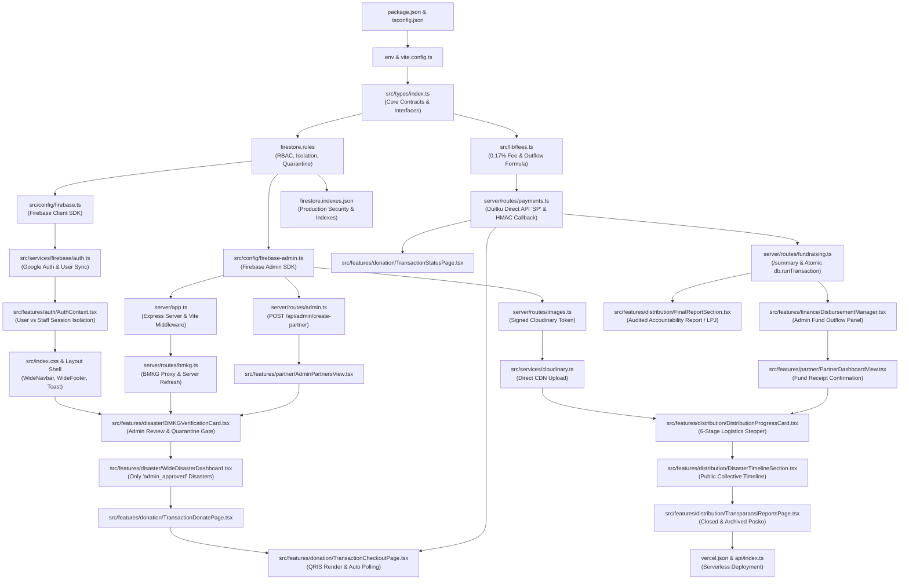

# Grafik Dependensi Modul (Implementation Dependency Graph)

Dokumen ini memetakan seluruh modul dan subsistem dalam platform **Bersama Kita** ke dalam arsitektur bertingkat (*layered architecture*). Dokumen ini menjelaskan ketergantungan antar-modul secara eksplisit untuk menjamin bahwa tidak ada komponen yang diimplementasikan sebelum dependensi dasarnya siap.

---

## 1. Diagram Ketergantungan Modul (Mermaid Diagram)

---

## 2. Analisis Tingkatan Arsitektur (Layer-by-Layer Architectural Breakdown)

### Layer 0: Tooling & Environment
- **Modul**: `package.json`, `tsconfig.json`, `vite.config.ts`, `.env.example`.
- **Peran**: Menjamin keselarasan engine kompilasi, pustaka dependensi, dan variabel lingkungan.
- **Mengapa Harus Pertama?**: Tanpa konfigurasi compiler dan module resolution yang valid, berkas TypeScript tidak dapat dikompilasi atau diuji.

---

### Layer 1: Core Types, Data Contracts & Security Rules
- **Modul**: `src/types/index.ts`, `src/lib/fees.ts`, `src/lib/firestore-errors.ts`, `firestore.rules`.
- **Peran**: Menetapkan kontrak tipe data terpusat, rumus biaya 0,17%, dan aturan deklaratif Firestore.
- **Mengapa Mendahului Backend & Frontend?**:
  * Seluruh endpoint Express dan komponen React mengimpor antarmuka dari `src/types/index.ts`.
  * `firestore.rules` wajib aktif sebelum kode frontend dijalankan agar tidak terjadi celah kebocoran data donasi privat selama proses pengujian.

---

### Layer 2: Backend Infrastructure & Database SDKs
- **Modul**: `src/config/firebase.ts`, `src/config/firebase-admin.ts`, `server/app.ts`, `api/index.ts`.
- **Peran**: Menyediakan koneksi database klien dan admin, serta server Express monolitik.
- **Mengapa Mendahului Fitur Bisnis?**:
  * Autentikasi dan operasi penulisan data memerlukan instance `auth`, `db`, dan `adminDb` yang terinisialisasi secara benar.
  * Polyfill `Referer` di `server/app.ts` harus aktif agar pemanggilan Firebase di lingkungan Node.js tidak ditolak oleh pembatasan API key.

---

### Layer 3: Authentication, Session Management & RBAC
- **Modul**: `src/services/firebase/auth.ts`, `src/lib/safe-storage.ts`, `src/features/auth/AuthContext.tsx`.
- **Peran**: Mengelola sesi Donatur (Google Auth) dan Staf (Admin & Mitra) secara terisolasi.
- **Mengapa Mendahului Halaman UI?**:
  * Tampilan navigasi dan kontrol akses rute (`PrivateRoute`) memerlukan status `isAdminAuthenticated` atau `isPartnerAuthenticated`.
  * Mencegah bug *permission denied* akibat residu token sesi lama di browser.

---

### Layer 4: Design System, UI Shell & Shared Feedback
- **Modul**: `src/index.css`, `src/lib/utils.ts`, `WideNavbar.tsx`, `WideFooter.tsx`, `Toast.tsx`, `Skeleton.tsx`.
- **Peran**: Menyediakan kerangka visual, sistem notifikasi, dan penanganan status pemuatan data.
- **Mengapa Mendahului Fitur Spesifik?**:
  * Semua halaman fitur dibangun di dalam shell navigasi ini dan menggunakan Toast untuk menampilkan umpan balik aksi pengguna.

---

### Layer 5: Disaster Data, BMKG Proxy & Quarantine Logic
- **Modul**: `src/services/bmkg.ts`, `server/routes/bmkg.ts`, `BMKGVerificationCard.tsx`.
- **Peran**: Ingesti data seismik dari BMKG dan karantina otomatis ke status `pending_verification`.
- **Mengapa Mendahului Alur Donasi?**:
  * Donasi tidak dapat dibuka tanpa adanya entitas bencana terverifikasi yang menjadi tujuan penyaluran bantuan.
  * Menjamin kepatuhan pada aturan mutlak: **data BMKG tidak pernah otomatis dipublikasikan**.

---

### Layer 6: Partner Management & Mandatory Assignment
- **Modul**: `server/routes/admin.ts`, `AdminPartnersView.tsx`, `WideDisasterDashboard.tsx`.
- **Peran**: Pembuatan akun mitra lapangan oleh admin dan penugasan wajib (*mandatory assignment*) sebelum bencana disetujui.
- **Mengapa Mendahului Donasi?**:
  * Bencana yang aktif di katalog wajib memiliki field `partnerId` dan `partnerName` yang valid agar alur penyaluran dana nantinya tidak mandek.

---

### Layer 7: QRIS Payment Gateway, Invoicing & Webhook Idempotency
- **Modul**: `server/routes/payments.ts`, `TransactionDonatePage.tsx`, `TransactionCheckoutPage.tsx`, `TransactionStatusPage.tsx`.
- **Peran**: Fasilitasi pembayaran donasi QRIS Duitku Direct API, verifikasi HMAC-SHA256, dan pencegahan duplikasi saldo.
- **Mengapa Bergantung pada Layer 5 & 6?**:
  * Transaksi donasi wajib mengikat ID bencana (`disasterId`) dan judul bencana terverifikasi.
  * Mutasi status donasi menjadi `paid` menjadi prasyarat pembentukan saldo kas bencana.

---

### Layer 8: Financial Ledger & Atomic Disbursement Engine
- **Modul**: `server/routes/fundraising.ts` (`/summary` & `/admin/disbursements`), `DisbursementManager.tsx`.
- **Peran**: Otorisasi pencairan dana dari saldo terkumpul menggunakan `db.runTransaction()`.
- **Mengapa Bergantung pada Layer 7?**:
  * Kas yang dicairkan bersumber secara nyata dari agregasi transaksi donasi yang telah berstatus `paid`.
  * Formula pencairan memvalidasi saldo kas terkumpul sebelum mengizinkan pengeluaran.

---

### Layer 9: Field Logistics, 6-Milestone Stepper & Signed Cloudinary Media
- **Modul**: `server/routes/images.ts`, `src/services/cloudinary.ts`, `PartnerDashboardView.tsx`, `DistributionProgressCard.tsx`.
- **Peran**: Konfirmasi penerimaan dana oleh mitra dan pembaruan 6 tahapan distribusi bantuan berbukti foto.
- **Mengapa Bergantung pada Layer 8?**:
  * Mitra hanya dapat memulai proses distribusi logistik setelah admin menyetujui pencairan dana dan mengalokasikannya ke ID mitra tersebut.

---

### Layer 10: Collective Public Timeline & Final Accountability Reporting (LPJ)
- **Modul**: `DisasterTimelineSection.tsx`, `FinalReportSection.tsx`, `TransparansiReportsPage.tsx`, `AdminFinalReportPanel.tsx`.
- **Peran**: Menampilkan garis waktu kronologis bantuan tanpa membocorkan data pribadi donatur, penutupan posko, dan publikasi LPJ final.
- **Mengapa Berada di Tingkat Akhir?**:
  * Timeline dan LPJ merangkum seluruh event dari transaksi donasi, pencairan dana, hingga bukti serah terima logistik di posko.

---

### Layer 11: Deployment, Production Hardening & E2E Validation
- **Modul**: `vercel.json`, `api/index.ts`, `firestore.indexes.json`.
- **Peran**: Konfigurasi serverless deployment di Vercel dan optimasi query komposit di Firestore.
- **Mengapa Paling Terakhir?**:
  * Deployment produksi dilakukan setelah seluruh komponen dan rute API teruji secara lokal tanpa error tipe data atau kebocoran keamanan.
